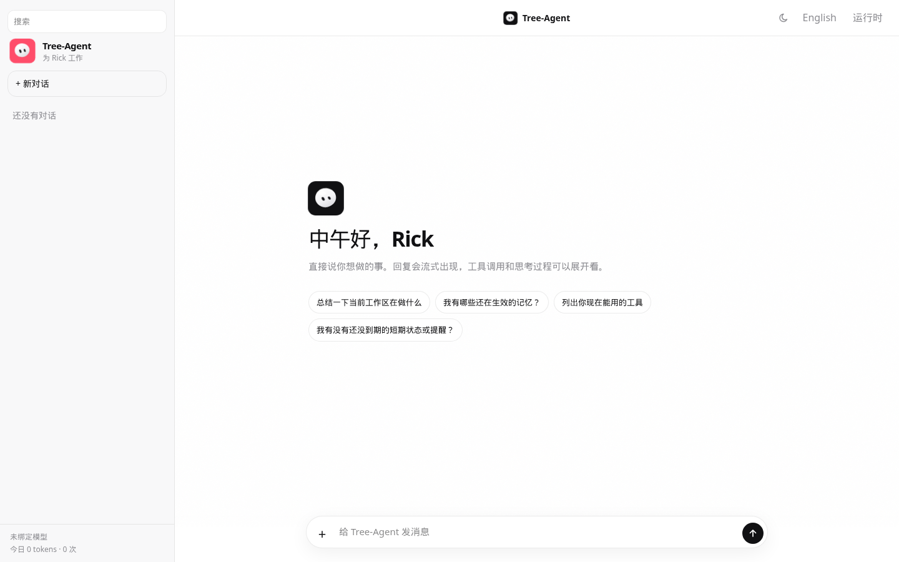
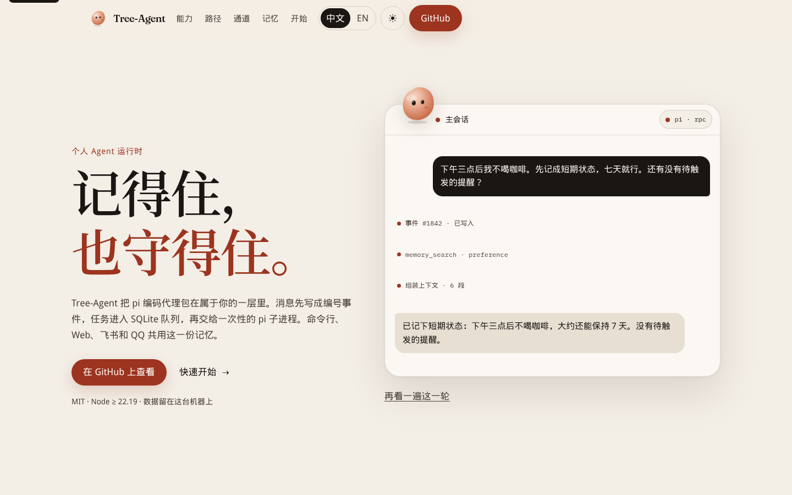
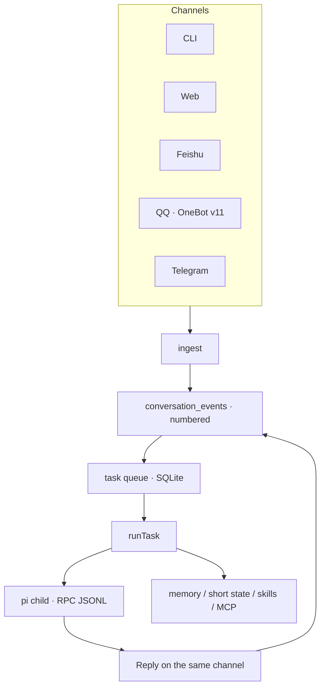

<div align="center">
  
  <h1>Tree-Agent</h1>
  <p>A personal agent runtime. pi does the thinking. Tree-Agent keeps the queue, the memory, and the boundary.</p>
  <p><a href="README.md">中文</a> · <strong>English</strong></p>
  <p>
    <a href="LICENSE"></a>
    <a href="package.json"></a>
    <a href="https://github.com/zeetree11/Tree-Agent/actions/workflows/ci.yml"></a>
    <a href="https://zeetree11.github.io/Tree-Agent/"></a>
  </p>
  
  <br>
  
</div>

Tree-Agent is not a fork of [pi](https://github.com/earendil-works/pi). pi (`@earendil-works/pi-coding-agent`) is the kernel, started as a one-shot child in `--mode rpc`. Tree-Agent is the orchestrator around it: a task queue, evidence-backed memory, channels, and a tool boundary. The npm package name is `tree-agent`. Paths and container names still say `pi-runtime` / `pi-rt`, so deployments that are already running do not have to be renamed. The command is `node src/cli.ts`.

The long-form reference (memory verdicts, context, Feishu, evals, deploy) is in Chinese: [docs/reference.md](docs/reference.md).

## Why Tree-Agent

A chat window does not give you these three:

- **State.** Tasks, events, and results live in SQLite with WAL. The executor can crash or be replaced. The place in the queue stays.
- **A boundary.** The executor has no database and opens no service port. Both sides speak JSONL. The runtime waits for `agent_settled`, not a single `agent_end`.
- **A seam.** The kernel can be swapped. Channels, memory, and approval stay in this layer.

## What it does

<table>
<tr>
<td width="56"></td>
<td><strong>A queue that survives a crash</strong><br>A task is written to SQLite before a worker claims it. The process can die. The place does not.</td>
</tr>
<tr>
<td width="56"></td>
<td><strong>A one-shot pi child</strong><br>No database, no service port. Credentials live in <code>data/pi</code>, not <code>~/.pi</code>.</td>
</tr>
<tr>
<td width="56"></td>
<td><strong>Memory needs evidence</strong><br>Each row is tied to one numbered event and a verbatim quote from a user message. Contested rows are not injected. Credential-shaped writes are refused.</td>
</tr>
<tr>
<td width="56"></td>
<td><strong>Channels are transport</strong><br>CLI, web, Feishu, QQ (OneBot v11), and Telegram call the same <code>ingest</code>. A redelivery does not become a second memory.</td>
</tr>
<tr>
<td width="56"></td>
<td><strong>Skills and MCP</strong><br>A skill is a <code>SKILL.md</code> on disk. The runtime reads the frontmatter and does not execute it. MCP uses pi’s own client. Readonly mode turns every <code>mcp__*</code> tool off.</td>
</tr>
<tr>
<td width="56"></td>
<td><strong>Persona, reminders, short state</strong><br><code>SOUL.md</code> is how it speaks. <code>CONTRACTS.md</code> is how it works. Reminders are pushed by the runtime when they are due. Things that should live a few days are short state with a TTL, written synchronously.</td>
</tr>
</table>

## Architecture



A message becomes a numbered event before any model call. If the reply fails, the evidence is still there.

## Quick start

Node.js ≥ 22.19. From the repo root:

```bash
npm install --ignore-scripts
node src/cli.ts doctor
node src/cli.ts list
```

`doctor` handshakes with pi. Before you log in, the pipe is open and the model shows as unknown, so a task cannot run yet.

Log in, then ask. Credentials are written to `data/pi`, not `~/.pi`. Without a provider key, `ask` fails and the failed task stays on record.

```bash
node src/cli.ts login
node src/cli.ts ask "用一句话说明这个仓库" --cwd .
node src/cli.ts worker
```

`login` opens pi’s own login flow. Quit when it is done.

## Channels

One `ingest`, several transports. In a Feishu or QQ group it answers a real @, or a wake word, and otherwise stays quiet.

### CLI

```bash
node src/cli.ts ask "<prompt>" --cwd .
node src/cli.ts worker          # daemon: claim queued tasks one by one
node src/cli.ts feed "<text>" --chat demo --as Ada   # pretend a speaker, locally
```

### Web

The browser channel is not a second runtime. It listens on `127.0.0.1:8788` and pushes status, tool calls, and text deltas over SSE. Every request sends `Authorization: Bearer <token>`. If `PI_RT_WEB_TOKEN` is unset, the process generates one, prints it, and writes it into the `web/dist` page it serves. Binding `--host` beyond loopback without that token is refused.

```bash
node src/cli.ts serve --channel web
# second terminal. The dev UI proxies /api to 8788
cd web && npm install && npm run dev
# http://127.0.0.1:5173
```

Or build the UI and let the runtime serve it:

```bash
cd web && npm run build
node src/cli.ts serve --channel web
# http://127.0.0.1:8788
```

A session is the thread `web:<id>`. Stopping a turn aborts that pi call. Text that already streamed is kept.

### Feishu

The long connection only needs outbound TLS. No public IP, domain, or certificate.

1. Create an internal app at [open.feishu.cn](https://open.feishu.cn) and add a bot.
2. Permissions: `im:message`, `im:message:send_as_bot`. Add `contact:user.base:readonly` if you want real names.
3. Subscribe to events over the long connection, and add `im.message.receive_v1`.
4. Publish a version and invite the bot into the chat.

```bash
export FEISHU_APP_ID=cli_xxx
export FEISHU_APP_SECRET=xxx
node src/cli.ts serve --channel feishu
```

`serve --channel feishu-webhook` is the mode for a public address, or for a local drill (`FEISHU_ENCRYPT_KEY`). Text messages only, for now. The signing steps are in [docs/reference.md](docs/reference.md).

### OneBot (QQ)

WebSocket in, HTTP out. NapCat or Lagrange.

```bash
export QQ_WS_URL=ws://127.0.0.1:3001/
export QQ_HTTP_URL=http://127.0.0.1:3000
node src/cli.ts serve --channel qq
```

The defaults in code are WS `ws://127.0.0.1:3001` and HTTP `http://127.0.0.1:3001`. Group allow-lists, mention bypass, and wake words are `QQ_ALLOW_GROUPS`, `QQ_GROUP_NO_MENTION`, and `QQ_WAKE_WORDS`. Desktop and headless deploy notes: [deploy/qq.md](deploy/qq.md), [deploy/qq-desktop/README.md](deploy/qq-desktop/README.md).

### Telegram

```bash
export TELEGRAM_BOT_TOKEN=xxx
node src/cli.ts serve --channel telegram
```

Long polling. No public address.

## Configuration

Copy `config.example.json` to `config.json` at the repo root (gitignored). Environment variables override the same fields.

| Variable | Default | What it does |
|---|---|---|
| `PI_RT_OWNER` | `ownerName` in `config.json`, else `Rick` | Canonical name of the owner. Memory is keyed by it |
| `PI_RT_OWNER_IDS` | empty | Other channel ids that also count as the owner, comma-separated |
| `PI_RT_PROVIDER` / `PI_RT_MODEL` | pi’s own default | The model. Or use `login` |
| `PI_RT_WORKSPACE` | current directory | Where the agent operates |
| `PI_RT_DATA_DIR` | `data/` | Database, memory, pi config |
| `PI_RT_SANDBOX` | `safe` | `readonly`, `safe`, or `full` |
| `PI_RT_MAX_MINUTES` | `30` | Wall-clock cap for one task |
| `PI_RT_WEB_HOST` | `127.0.0.1` | Web bind address |
| `PI_RT_WEB_PORT` | `8788` | Web port |
| `PI_RT_WEB_TOKEN` | generated on loopback | Required once you leave loopback |
| `FEISHU_APP_ID` / `FEISHU_APP_SECRET` | unset | Feishu app credentials |
| `TELEGRAM_BOT_TOKEN` | unset | Telegram |
| `QQ_WS_URL` / `QQ_HTTP_URL` | `127.0.0.1:3001` | OneBot receive and send |
| `EMBEDDING_BASE_URL` | empty | When set, retrieval uses a compatible embeddings endpoint. Otherwise it uses the offline hash embedding |

Memory budget, context window, retries, and the daily token cap are in [config.example.json](config.example.json) and [src/config.ts](src/config.ts).

## Memory

Three layers: evidence, subject, verdict.

- Evidence has to be a verbatim substring of **one user message**. The assistant restating it does not count.
- The owner is configured. It is not “whoever spoke first”.
- Verdicts are `create`, `correct`, `invalidate`, and `contest`. Contested rows are not injected. Settle one with `node src/cli.ts resolve <key> <keep-id>`.
- Search defaults to an offline hash embedding, which only catches surface similarity. Set `EMBEDDING_BASE_URL`, `EMBEDDING_API_KEY`, and `EMBEDDING_MODEL` to use a compatible vector endpoint. The knowledge base is stored apart from memory.

Write one by hand:

```bash
node src/cli.ts remember "默认使用 bash" --key user_shell --category fact --target self
node src/cli.ts memories
```

The verdict rules, scope, conflicts, and when distillation runs are in [docs/reference.md](docs/reference.md).

## Skills

`SKILL.md` files are discovered the Agent Skills way:

- User: `<data>/.agents/skills/<name>/SKILL.md`
- Project: `.agents/skills/` from the repo root down to the working directory

The nearer project skill wins a name clash. The scanner reads frontmatter only. It does not run scripts inside a skill.

```bash
node src/cli.ts skills
```

## MCP

The protocol is not reimplemented. pi is already the client. Servers are listed in `mcp.json` under `data`, and the runtime points pi at that file.

Hand-written servers in this repo:

| server | tools |
|---|---|
| `fetch-server` | `fetch`, `search`, with SSRF checks |
| `memory-server` | `memory_search`. Read-only, active rows only |
| `knowledge-server` | `knowledge_search`, `knowledge_list`, `knowledge_add` |
| `spawn-server` | `fanout`, `orchestrate`, notes, file locks, `send`, `propose_self_edit` |

One runtime owns scheduling. The servers are thin clients of `127.0.0.1:8899`. That control API has no auth. Do not expose it. `readonly` excludes `mcp__*`, because an MCP server declares its own powers and we cannot tell whether it writes.

`propose_self_edit` may ask to change `persona/SOUL.md`, `persona/CONTRACTS.md`, or to add an MCP server. A person has to approve it, and it can be rolled back. `src/**` is always refused.

## Security

This is capability limiting, not a container.

| mode | bash | write | MCP |
|---|---|---|---|
| `readonly` | off | off | off |
| `safe` (default) | off | on | on |
| `full` | on | on | on |

- The child does not inherit the full environment. Even in `full`, a shell cannot echo `FEISHU_APP_SECRET`.
- `read` can still open any file you can open, including pi’s own credentials. For untrusted work, use `readonly`.
- Memory writes that look like credentials are refused. Raw conversation events are still stored in clear text in `conversation_events`.
- The web channel binds to loopback unless you set `PI_RT_WEB_TOKEN`. Without the token, a non-loopback bind is refused.
- Do not commit `config.json` or `deploy/.env`.

## Project structure

```
src/            runtime: CLI, queue, memory, worker, orchestration
src/channels/   Feishu, Feishu webhook, OneBot, Telegram, web
mcp/            hand-written MCP servers
web/            browser UI
skills/         skills shipped in the repo
deploy/         Docker, systemd, QQ
docs/           long-form reference and landing-page assets
site/           landing page, built to site/dist
eval/           memory-extraction cases
tests/          node tests
```

Deploy files (Dockerfile, compose, systemd) are in [deploy/README.md](deploy/README.md). One instance: one SQLite file, one long connection. It does not scale out.

## Landing page

The source is `site/`. Asset URLs are relative, so on the GitHub Pages project site the base path is the repo directory `/Tree-Agent/`: <https://zeetree11.github.io/Tree-Agent/>.

```bash
cd site
npm install
npm run dev      # http://127.0.0.1:4173
npm run build    # writes site/dist
```

`.github/workflows/pages.yml` builds and deploys when `site/` changes on `main`. The repository’s Pages source has to be GitHub Actions. The workflow file does not flip that switch for you.

## Not done yet

These are gaps the repo already names. They are not a schedule. [ROADMAP.md](ROADMAP.md) is the working notebook, and some early items there are already done. The list that still applies is the one at the end of [docs/reference.md](docs/reference.md).

- Images, files, and audio are skipped, not parsed.
- pi emits text deltas, but they are not pushed out to Feishu or QQ yet.
- One machine, one SQLite file. No horizontal scale-out.
- The sandbox is not a container. Real isolation is not built.
- Work that spans many turns has no lifecycle of its own. Memory and the summary carry it.

## Contributing

```bash
npm ci --ignore-scripts
node scripts/test-all.mjs
```

Node.js ≥ 22.19. Install with `--ignore-scripts`: pi does not need a lifecycle script, and sandboxes often block them. When you touch memory or a channel, run the matching `tests/*.test.mjs`.

## License

[MIT](LICENSE). Copyright (c) 2026 zeetree11.

## Acknowledgements

The kernel is [@earendil-works/pi-coding-agent](https://github.com/earendil-works/pi). Two ideas in the persona files come from [Tobs’ `soul.ts`](https://github.com/BotHarness/DeepSeekBot/blob/main/packages/core/src/memory/soul.ts) and [Yuki’s contracts](https://github.com/YuanYeYouTao/Yuki): a character budget, and splitting “how to speak” from “how to work”.
