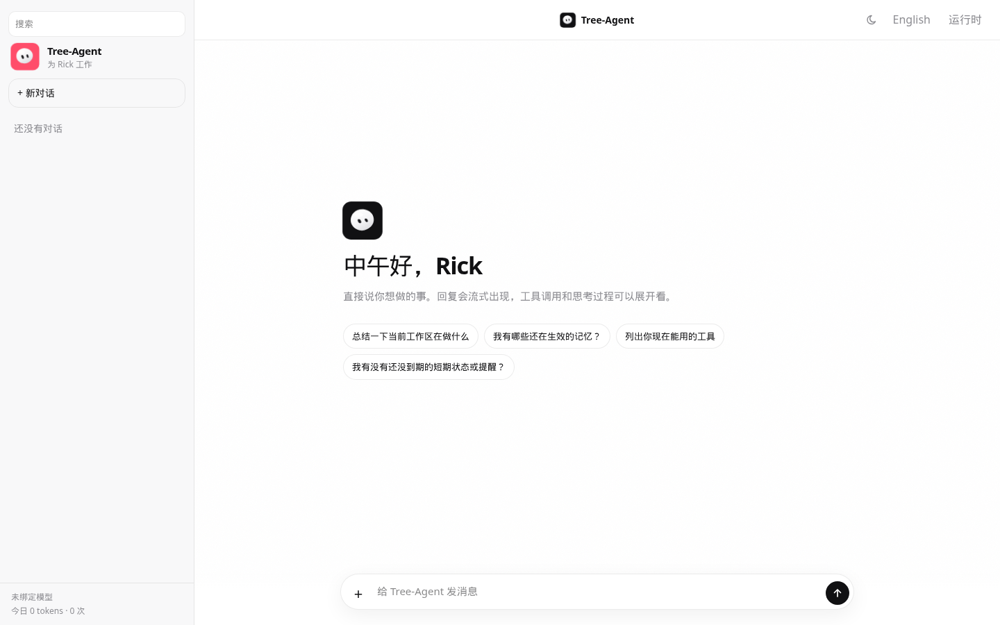
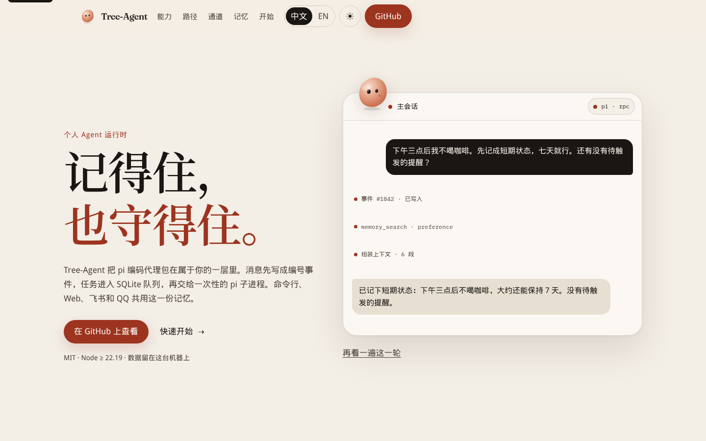
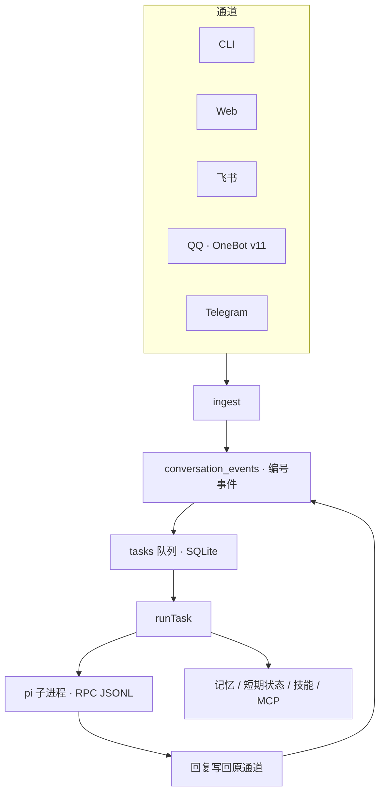

<div align="center">
  
  <h1>Tree-Agent</h1>
  <p>个人 Agent 运行时。pi 负责想和做，Tree-Agent 负责记得住、排好队、守住边界。</p>
  <p><strong>中文</strong> · <a href="README.en.md">English</a></p>
  <p>
    <a href="LICENSE"></a>
    <a href="package.json"></a>
    <a href="https://github.com/zeetree11/Tree-Agent/actions/workflows/ci.yml"></a>
    <a href="https://zeetree11.github.io/Tree-Agent/"></a>
  </p>
  
  <br>
  
</div>

Tree-Agent 不是 [pi](https://github.com/earendil-works/pi) 的 fork。pi（`@earendil-works/pi-coding-agent`）是执行内核，以一次性子进程跑在 `--mode rpc`。Tree-Agent 是外面的编排层：任务队列、证据记忆、通道和工具边界。npm 包名是 `tree-agent`。路径和容器名里的 `pi-runtime` / `pi-rt` 保留着，避免改掉已经在跑的部署。命令行入口是 `node src/cli.ts`。

长文（记忆裁决、上下文编排、飞书接入、评测、部署）在 [docs/reference.md](docs/reference.md)。

## 为什么是 Tree-Agent

聊天窗口给不了这三样东西：

- **状态。** 任务、事件、结果写在 SQLite（WAL）里。执行器崩溃或被换掉，队列的位置还在。
- **边界。** 执行器不连数据库，也不占服务端口。stdin / stdout 都是 JSONL。运行时等的是 `agent_settled`，不是单独的一次 `agent_end`。
- **接缝。** 内核可以换。通道、记忆和审批是这一层的。

## 它能做的事

<table>
<tr>
<td width="56"></td>
<td><strong>队列扛得住崩溃</strong><br>任务先进 SQLite，再由 worker 领取。进程没了，位置还在。</td>
</tr>
<tr>
<td width="56"></td>
<td><strong>一次性的 pi 子进程</strong><br>不连数据库，不占端口。凭证放在 <code>data/pi</code>，不碰 <code>~/.pi</code>。</td>
</tr>
<tr>
<td width="56"></td>
<td><strong>证据才算记忆</strong><br>每条记忆绑到一条编号事件和逐字引文，而且必须来自用户消息。争议行不注入。凭据形状的写入会被拒绝。</td>
</tr>
<tr>
<td width="56"></td>
<td><strong>通道只是运输</strong><br>CLI、Web、飞书、QQ（OneBot v11）、Telegram 走同一条 <code>ingest</code>。重投不会变成第二条记忆。</td>
</tr>
<tr>
<td width="56"></td>
<td><strong>技能与 MCP</strong><br>技能是磁盘上的 <code>SKILL.md</code>，只读 frontmatter。MCP 用 pi 自己的客户端。只读沙箱会关掉全部 <code>mcp__*</code>。</td>
</tr>
<tr>
<td width="56"></td>
<td><strong>人格、提醒、短状态</strong><br><code>SOUL.md</code> 管怎么说，<code>CONTRACTS.md</code> 管怎么干。提醒到点由运行时推送。只活几天的事用带 TTL 的短期状态，同步落库。</td>
</tr>
</table>

## 架构



消息在任何模型调用之前就变成编号事件。回复失败，证据还在。

## 快速开始

需要 Node.js ≥ 22.19。在仓库根目录：

```bash
npm install --ignore-scripts
node src/cli.ts doctor
node src/cli.ts list
```

`doctor` 会和 pi 握手。还没登录时，管道是通的，但模型显示为 unknown，任务还不能跑。

绑定模型后再问一句。凭证写到 `data/pi`，不是 `~/.pi`。没有 provider 密钥时，`ask` 会失败，并把这次失败留在任务记录里。

```bash
node src/cli.ts login
node src/cli.ts ask "用一句话说明这个仓库" --cwd .
node src/cli.ts worker
```

`login` 会打开 pi 自己的登录，完成后退出即可。

## 通道

一条 `ingest`，几种运输。群里的飞书和 QQ 默认只有真 @ 到它，或命中唤醒词，才回复。

### CLI

```bash
node src/cli.ts ask "<prompt>" --cwd .
node src/cli.ts worker          # 守护进程，逐个领队列
node src/cli.ts feed "<text>" --chat demo --as 张三   # 本地模拟一个说话人
```

### Web

浏览器通道不是第二套运行时。默认只听 `127.0.0.1:8788`，用 SSE 把状态、工具调用和文本增量推回去。每个请求带 `Authorization: Bearer <token>`。没设 `PI_RT_WEB_TOKEN` 时，进程自己生成一把，打在日志里，并写进它托管的 `web/dist`。`--host` 离开 loopback 时必须自己设置这把令牌。

```bash
node src/cli.ts serve --channel web
# 另开一个终端。开发界面把 /api 代理到 8788
cd web && npm install && npm run dev
# http://127.0.0.1:5173
```

先构建再由运行时托管界面：

```bash
cd web && npm run build
node src/cli.ts serve --channel web
# http://127.0.0.1:8788
```

会话线程是 `web:<id>`。停止生成会中止当前这次 pi 调用，已经流出的文字会留下来。

### 飞书

长连接只需要出站 TLS，不要公网 IP、域名或证书。

1. [open.feishu.cn](https://open.feishu.cn) 创建企业自建应用，加上机器人。
2. 权限：`im:message`、`im:message:send_as_bot`。要真实姓名再加 `contact:user.base:readonly`。
3. 事件订阅选「使用长连接接收事件」，添加 `im.message.receive_v1`。
4. 发布版本，把机器人加进会话。

```bash
export FEISHU_APP_ID=cli_xxx
export FEISHU_APP_SECRET=xxx
node src/cli.ts serve --channel feishu
```

有公网地址，或只想在本地演练时，用 `serve --channel feishu-webhook`（需要 `FEISHU_ENCRYPT_KEY`）。目前只接文本消息。步骤和验签细节在 [docs/reference.md](docs/reference.md)。

### OneBot（QQ）

WebSocket 收，HTTP 发。NapCat 或 Lagrange 都可以。

```bash
export QQ_WS_URL=ws://127.0.0.1:3001/
export QQ_HTTP_URL=http://127.0.0.1:3000
node src/cli.ts serve --channel qq
```

默认地址写在代码里：WS `ws://127.0.0.1:3001`，HTTP `http://127.0.0.1:3001`。群白名单、免 @、唤醒词用 `QQ_ALLOW_GROUPS`、`QQ_GROUP_NO_MENTION`、`QQ_WAKE_WORDS`。有桌面和无桌面的部署分别看 [deploy/qq.md](deploy/qq.md) 和 [deploy/qq-desktop/README.md](deploy/qq-desktop/README.md)。

### Telegram

```bash
export TELEGRAM_BOT_TOKEN=xxx
node src/cli.ts serve --channel telegram
```

长轮询，不需要公网地址。

## 配置

复制 `config.example.json` 为仓库根目录的 `config.json`（已在 `.gitignore` 里）。环境变量覆盖同名字段。

| 变量 | 默认 | 作用 |
|---|---|---|
| `PI_RT_OWNER` | `config.json` 的 `ownerName`，否则 `Rick` | 主人的规范名字。记忆按这个主体归 |
| `PI_RT_OWNER_IDS` | 空 | 也算主人的渠道 id，逗号分隔 |
| `PI_RT_PROVIDER` / `PI_RT_MODEL` | pi 自己的默认 | 模型。也可以 `login` |
| `PI_RT_WORKSPACE` | 当前目录 | agent 操作的工作区 |
| `PI_RT_DATA_DIR` | `data/` | 数据库、记忆、pi 配置 |
| `PI_RT_SANDBOX` | `safe` | `readonly` / `safe` / `full` |
| `PI_RT_MAX_MINUTES` | `30` | 单任务墙钟上限 |
| `PI_RT_WEB_HOST` | `127.0.0.1` | Web 通道绑定地址 |
| `PI_RT_WEB_PORT` | `8788` | Web 通道端口 |
| `PI_RT_WEB_TOKEN` | 本机自动生成 | 离开 loopback 时必须自己设置 |
| `FEISHU_APP_ID` / `FEISHU_APP_SECRET` | 无 | 飞书应用凭证 |
| `TELEGRAM_BOT_TOKEN` | 无 | Telegram |
| `QQ_WS_URL` / `QQ_HTTP_URL` | `127.0.0.1:3001` | OneBot 收发地址 |
| `EMBEDDING_BASE_URL` | 空 | 设置后检索走兼容的向量接口。不设则用离线 hash embedding |

其余字段（记忆预算、上下文窗口、重试、每日 token 上限）见 [config.example.json](config.example.json) 和 [src/config.ts](src/config.ts)。

## 记忆

三层：证据、主体、裁决。

- 证据必须是**某一条用户消息**的逐字子串。助手的复述不算。
- 主体是配置出来的，不靠「谁先说话」。
- 裁决是 `create` / `correct` / `invalidate` / `contest`。有争议的行不注入。用 `node src/cli.ts resolve <key> <keep-id>` 人工裁定。
- 默认检索是离线 hash embedding，只抓字面相似。把 `EMBEDDING_BASE_URL`、`EMBEDDING_API_KEY`、`EMBEDDING_MODEL` 指到兼容接口后，才走那套向量。知识库和记忆分开存。

手写一条：

```bash
node src/cli.ts remember "默认使用 bash" --key user_shell --category fact --target self
node src/cli.ts memories
```

四态、作用域、冲突和提炼时机见 [docs/reference.md](docs/reference.md)。

## 技能

按 Agent Skills 的约定发现 `SKILL.md`：

- 用户级：`<data>/.agents/skills/<name>/SKILL.md`
- 项目级：从仓库根到当前工作区的 `.agents/skills/`

同名时，更近的项目技能盖过用户技能。扫描器只读 frontmatter，不执行技能里的脚本。

```bash
node src/cli.ts skills
```

## MCP

协议不用重写，pi 已经是客户端。配置在 `data` 下的 `mcp.json`，运行时把它指到 pi 真正去读的位置。

仓库里的手写 server：

| server | 工具 |
|---|---|
| `fetch-server` | `fetch`、`search`。带 SSRF 防护 |
| `memory-server` | `memory_search`。只读，只返回 active |
| `knowledge-server` | `knowledge_search`、`knowledge_list`、`knowledge_add` |
| `spawn-server` | `fanout`、`orchestrate`、便签、文件锁、`send`、`propose_self_edit` |

调度只在运行时一处。server 是薄客户端，打到本机 `127.0.0.1:8899`。这个控制 API 没有鉴权，不要暴露到机器外面。`readonly` 会排除 `mcp__*`，因为 MCP server 自己声明能力，我们无法确认它是不是只读。

`propose_self_edit` 只能申请改 `persona/SOUL.md`、`persona/CONTRACTS.md` 或新增 MCP server，必须人批准，可以回滚。`src/**` 永远拒绝。

## 安全

这里做的是能力限制，不是容器隔离。

| 模式 | bash | 写文件 | MCP |
|---|---|---|---|
| `readonly` | 关 | 关 | 关 |
| `safe`（默认） | 关 | 开 | 开 |
| `full` | 开 | 开 | 开 |

- 子进程不继承全部环境变量。`full` 模式下也 echo 不到 `FEISHU_APP_SECRET`。
- `read` 仍能读你有权读的文件，包括 pi 自己的凭证。不可信任务只用 `readonly`。
- 记忆写入会拒绝凭据形状的内容。原始对话事件目前仍明文留在 `conversation_events`。
- Web 通道默认只绑 loopback。绑到其他地址却没设 `PI_RT_WEB_TOKEN`，进程直接拒绝启动。
- 不要提交 `config.json` 和 `deploy/.env`。

## 项目结构

```
src/            运行时：CLI、队列、记忆、worker、编排
src/channels/   飞书、飞书 webhook、OneBot、Telegram、Web
mcp/            手写 MCP server
web/            浏览器界面
skills/         仓库自带的 skill
deploy/         Docker、systemd、QQ
docs/           长文参考和落地页素材
site/           落地页，构建到 site/dist
eval/           记忆抽取用例
tests/          node 测试
```

部署（Dockerfile、compose、systemd）见 [deploy/README.md](deploy/README.md)。单实例：一个 SQLite，一条长连接，不能水平扩容。

## 落地页

源码在 `site/`。资源用相对路径，GitHub Pages 项目站的 base path 就是仓库目录 `/Tree-Agent/`，地址是 <https://zeetree11.github.io/Tree-Agent/>。

```bash
cd site
npm install
npm run dev      # http://127.0.0.1:4173
npm run build    # 输出 site/dist
```

`.github/workflows/pages.yml` 会在 `main` 上 `site/` 变化时构建并部署。仓库的 Pages 来源要选 GitHub Actions，工作流本身不会替你打开这个开关。

## 还没做的

这些是仓库里已经写明的缺口，不是排期。[ROADMAP.md](ROADMAP.md) 是按阶段记的工作笔记，有些早期条目后来已经做完，以 [docs/reference.md](docs/reference.md) 末尾的「已知缺口」为准。

- 图片、文件、语音会跳过，不解析。
- pi 有文本增量，但还没有推到飞书或 QQ 的出口。
- 一台机器、一个 SQLite，不能水平扩展。
- 沙箱不是容器。真正的隔离还没做。
- 跨很多轮的「持续工作」没有单独的状态机，靠记忆和摘要撑着。

## 参与贡献

```bash
npm ci --ignore-scripts
node scripts/test-all.mjs
```

Node.js ≥ 22.19。安装请带 `--ignore-scripts`：pi 不需要生命周期脚本，沙箱里也常被拦住。改动记忆或通道时，跑对应的 `tests/*.test.mjs`。

## 许可

[MIT](LICENSE)。Copyright (c) 2026 zeetree11.

## 致谢

执行内核是 [@earendil-works/pi-coding-agent](https://github.com/earendil-works/pi)。人格文件的两处做法来自 [Tobs 的 `soul.ts`](https://github.com/BotHarness/DeepSeekBot/blob/main/packages/core/src/memory/soul.ts) 和 [Yuki 的 contracts](https://github.com/YuanYeYouTao/Yuki)：字符预算，以及把「怎么说」和「怎么干」拆开。
